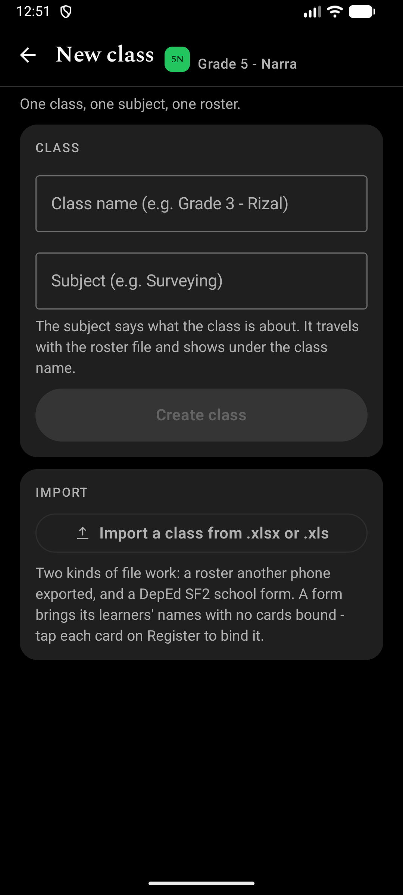
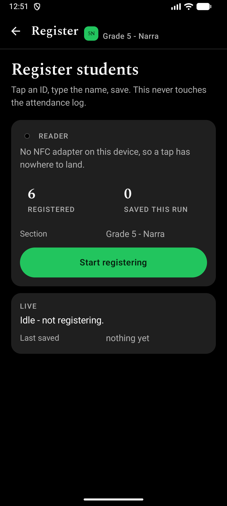
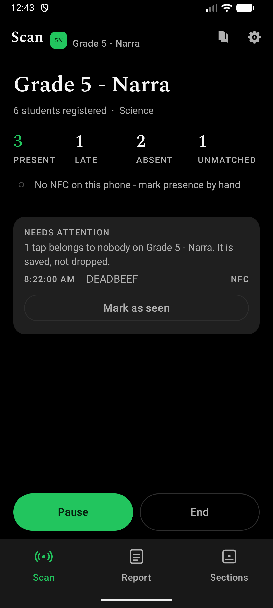
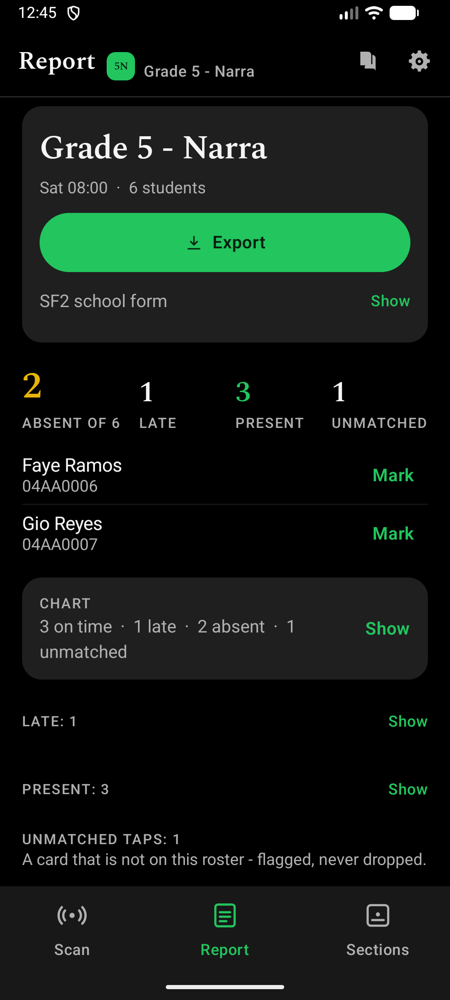
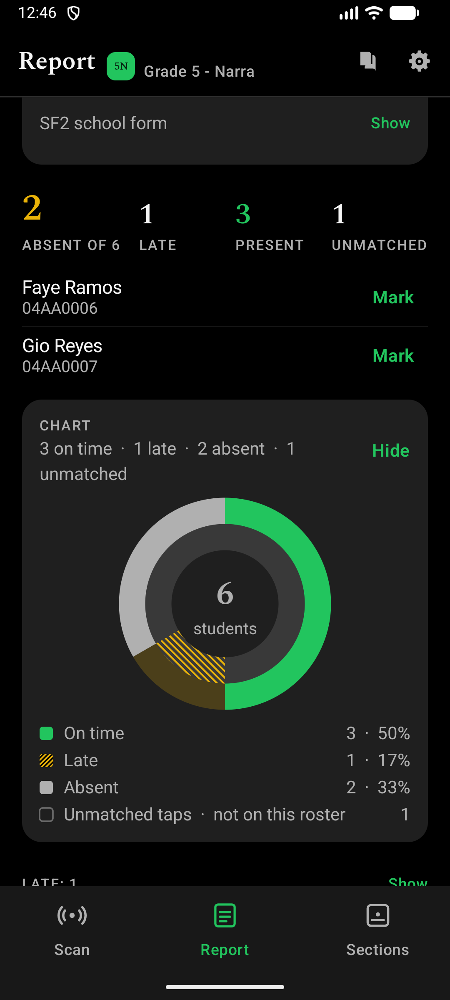
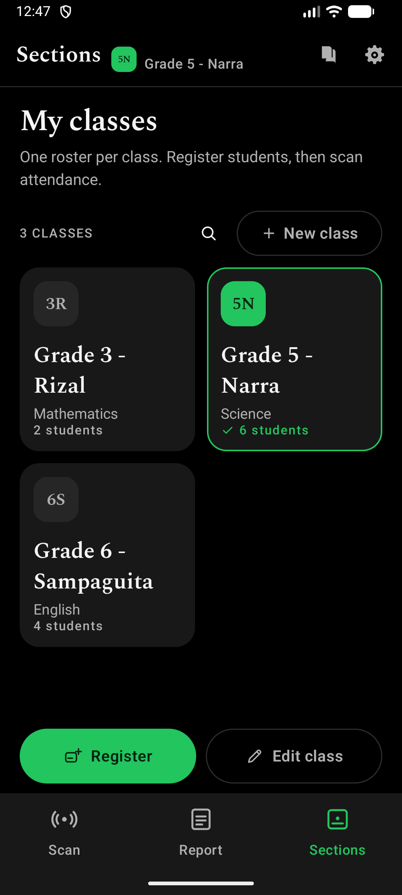

#  Presencia NFC - Attendance Checker


## **Tap your ID. Be Present.**

An offline Android app for taking class attendance by tapping student ID cards.

Built for a **class beadle**: one roster per class, tap each card once, then export the session as an Excel workbook. The app ships as **Presencia NFC**; the repository keeps its original name.

**No server. No network permission. No student numbers** — a student is a name and a card UID, plus the M/F a school form itself prints, nothing else.

## ✨ What it does

- **🗂️ Classes** — one plate per class: the **name** at reading size, its **subject**, its roster count, and a **two-letter mark derived from the name** (`Grade 3 - Rizal` reads `3R`). Nothing has to be picked or memorised, and the chosen class is the only one with a green edge. The magnifier beside *New class* searches by **class name or subject**.

- **🪪 Register** — tap an ID card, type the name, and save. A card already on the roster **updates its name** instead of adding a second row. A class read from a school form arrives with names but **no cards**; the same card panel lists **This card belongs to** every learner still waiting, with a search box, so binding a card never means typing a name.

- **📡 Scan** — tap each card once per session. A repeat read of the same student is **refused**, naming the time they were first recorded. A read more than **15 minutes** after the session starts is still counted, but marked **late**. The threshold can be set to **10/15/20/30 minutes**. The session can also be paused and left open for late arrivals, and the last card read stays on screen with an **Undo** beside it.
  - **Every answer has a sound**, because at a door the teacher is looking at the student, not the screen: a clean tick for on time, a two-note rise for late, a low double knock for a card already counted, a buzz for a card that is not on the roster, and one long tone when there is nothing to record against. The tones are generated on the phone, play in silent mode, and can be switched off in Settings.
  - **The screen never claims to be ready while the antenna is deaf.** If NFC is off the live bar says **NFC is off** and offers one 48 dp button that opens the system's NFC switch; a phone with no NFC adapter says so in words. A **paused** session is also the only place that says paused.

- **📈 Chart** — the Session report draws the numbers it states: a **pie** of on time / late / absent, a **line** of how the room filled against the late mark, or a **bar** of how each presence was recorded (NFC or by hand, with QR only in sessions recorded before 0.0.9). The card stays closed until it is tapped, so the absent list is what the tab opens on. Settings chooses the lens, and the legend under every chart writes the figures out, so nothing depends on colour alone; an unmatched tap gets a **hollow** chip, because it is counted but is not one of the class.

- **📋 Report** — **absent** first, then **late**, **present**, and **unmatched** cards. Every attendance row carries the **date and time** of the read. The tab opens on the class's latest session even after the app was closed, and a learner with no card can be **marked present by hand**.

- **🏫 School form (SF2)** — import a DepEd SF2 form as a class (names and M/F, no cards), and print a class's month back as the same form from the Report tab: one column per school day, male and female blocks, per-learner ABSENT/PRESENT, remarks, enrolment and percentage. **Blank** is present, **x** absent, **L** late, **-** no session that day, **N** no card yet.

- **📊 Export / Import** — write the report or roster to `.xlsx` in the shared **`Documents/Presencia`** folder, or import a class from a file. Rows merge by **card UID**, and the **subject travels with the file**. Import reads modern `.xlsx` **and legacy `.xls`** files that carry the app's own *Roster* sheet, and it also reads a **DepEd SF2 school form** — see above.

## Class plates

A class is a **plate**, not a playing card. The name is the biggest thing on it,
the subject is one grey line under it, the roster count sits at the bottom, and
the chosen class is the only one with a green edge and a green mark. Plates in a
row grow together, so a two-line name never clips the count.

The mark is **derived from the name** - the last dash-separated word gives the
letter, the first number gives the digits:

| Name | Mark |
| --- | --- |
| Grade 3 - Rizal | 3R |
| Grade 3 - Sampaguita | 3S |
| Grade 12 - Mabini | 12M |
| BSCE-4B | 4B |
| Narra | NA |

Nothing is picked, stored, or kept unique, so a mark cannot drift from the class
it stands for, and no class ever runs out of faces. The old style switch is gone
with the deck: there is one look, and it is the same on every screen.

## Screens

| New class | Register |
| --- | --- |
|  |  |

| Scan | Report |
| --- | --- |
|  |  |

| Chart | Classes |
| --- | --- |
|  |  |

One question per tab, and one control per tab. **Scan** states the session in four
numbers on a single line and keeps **Start / Pause / End** pinned above the tab bar,
never scrolled away; the running session also rides along as a one-line player on the
other tabs. **Report** leads with the learners who are absent, because that is the
list a teacher acts on, and keeps the drawing collapsed until it is asked for.

Also included: a registered-students page for the full roster with per-student
standing, a full-screen student editor, Settings and **How to use** as two icons
in the header, light and dark themes, a first-launch six-step guide, and scan
feedback (haptics strength, plus the door tones above).

## Privacy

Names and card UIDs live in this app's private storage only. The app has no
network permission, so nothing can be uploaded. The only data that leaves the
device is what you export yourself into `Documents/Presencia`. The RA 10173
privacy paragraph is shown in the app.

The learner files are also excluded from **Android's cloud backup and from
phone-to-phone transfer**, so the promise in Settings survives the operating
system: thirty names and their card UIDs never reach Google Drive, and a new
phone starts empty. The last crash is kept in private storage so Settings can
show it, and it is never uploaded either.

**NFC** is the only hardware the app uses: there is no camera code and no **CAMERA** permission, and **INTERNET** is still absent. The QR fallback was removed in 0.0.9; the only trace it leaves is the **QR** value older sessions kept in their recorded-method column, so their reports and exports stay truthful.

## Build

```bash
export JAVA_HOME="/path/to/Android/Studio/jbr"
./gradlew :app:assembleDebug          # APK
./gradlew :app:testDebugUnitTest      # unit tests
./gradlew :app:connectedDebugAndroidTest   # instrumented tests (needs a device)
```

Kotlin, Jetpack Compose and Material 3. Gradle builds the `.xlsx` writer and
reader by hand over `java.util.zip` - no Apache POI, no third-party spreadsheet
library, no charting or image-loading dependency.

## Documentation

- [CHANGELOG.md](CHANGELOG.md) - what changed between releases
- [docs/UI-UX-AUDIT.md](docs/UI-UX-AUDIT.md) - the ten ranked usability findings
- [docs/UI-UX-CHECKLIST.md](docs/UI-UX-CHECKLIST.md) - what was fixed, with evidence
- [docs/NFC-Attendance-Checker-Guide.html](docs/NFC-Attendance-Checker-Guide.html) - illustrated guide
- [docs/GITHUB-PUBLISH.md](docs/GITHUB-PUBLISH.md) - release steps

## Licence

See [LICENSE](LICENSE).
